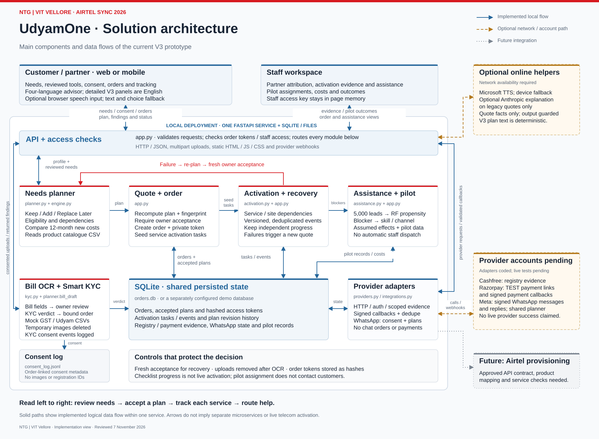

# Solution architecture

UdyamOne is a modular FastAPI application with a static browser interface. Local demonstrations use SQLite; the secure pilot configuration uses PostgreSQL and Alembic migrations. The diagram describes the case prototype and distinguishes optional external connections from future telecom provisioning.

[PDF diagram](docs/NTG_VITVELLORE_Architecture.pdf) | [Editable Mermaid source](docs/NTG_VITVELLORE_Architecture.mmd)

## Components

| Component | Responsibility |
| --- | --- |
| Browser application | Customer needs, reviewed inventory, consent, order tracking and staff workspace |
| API and access checks | Request validation, customer OTP sessions, OIDC staff roles, local order-token compatibility and module routing |
| Needs planner | Catalogue eligibility, product dependencies, scoped quantities and 12-month new-charge comparison |
| Quote and order handling | Server recomputation, plan fingerprint validation, acceptance and task creation |
| OCR and KYC | Candidate bill fields, document checks and accepted-order identity binding |
| Activation and recovery | Service/location dependencies, versioned evidence events and revised-plan acceptance |
| Assistance and pilot | Blocker routing, propensity-based analysis, assumed intervention effects and recorded outcomes |
| Provider adapters | Authenticated requests, signature validation, scoped evidence and reconciliation |
| PostgreSQL / local SQLite | Accepted plans, order data, tasks, integration state, authentication state and purpose-specific consent metadata |

## Main data flows

1. The browser submits structured needs and reviewed existing services. The planner reads the local catalogue and returns decisions, prices and unresolved questions.
2. Order acceptance triggers server-side recomputation and a fingerprint check. The server stores the accepted plan, hashes a random access token and creates service tasks.
3. Bill and KYC uploads require consent. Images are processed in temporary storage and removed after processing. Reviewed bill facts may enter a plan; KYC status/verdict updates the order and finding codes enter the consent log.
4. Staff evidence updates service tasks through version and duplicate checks. Failures affect the relevant dependency branch. Recovery requires a new accepted plan and preserves unchanged completed work.
5. Optional provider requests use server-held credentials. Validated callbacks update integration state only after signature, identity, reference and amount checks as applicable.
6. Assistance routes blockers to the relevant skill. Pilot assignment records an experiment arm; it does not send outreach or dispatch staff.

## Storage and trust boundaries

PostgreSQL is the pilot system of record for business/contact fields, accepted plans, task and revision history, payment/registry evidence, WhatsApp state, authentication and consent events. Local demos may use `orders.db` plus a compatibility JSONL consent log. Order-linked records are pseudonymous rather than anonymous.

The pilot foundation supports phone-OTP customer bearer sessions and OIDC staff bearer tokens with role checks. Local demo orders retain random access tokens stored as SHA-256 hashes; `ADMIN_TOKEN` is local/staging compatibility only. Production refuses demo mode, shared staff-token authentication, mock KYC and non-PostgreSQL storage.

The core deployment is one application, not independent microservices. OCR is local. Optional Microsoft speech and browser speech recognition cross network boundaries. Anthropic explanations are restricted to approved quote facts on the legacy quote path; the V3 reviewed-context path is deterministic.

## Integration boundaries

Cashfree provides registry evidence, not complete telecom KYC. Razorpay is restricted to test payment links. Meta supports a consent-led WhatsApp pilot and phone-bound order tracking. Adapters require account-level acceptance tests before real use.

Airtel provisioning is not connected. Production integration requires an approved API contract, catalogue mapping, feasibility/scheduling operations and service-activation checks. A staff-recorded task event is not a provider activation confirmation.

See [INTEGRATIONS.md](INTEGRATIONS.md) for provider interfaces and [PRIVACY.md](PRIVACY.md) for data handling and production security requirements.
