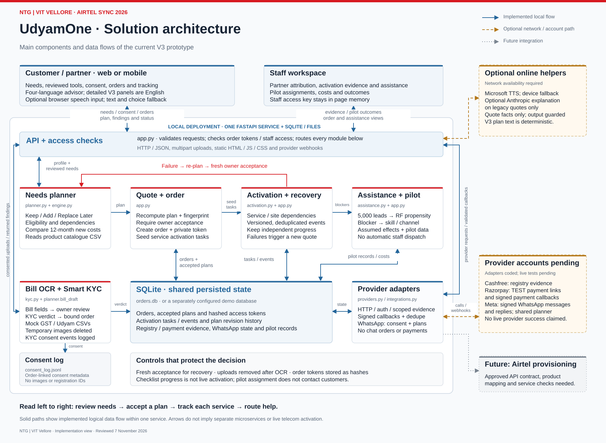

# UdyamOne

MSME service discovery and onboarding, developed by **Team NTG, VIT Vellore** for Airtel SYNC 2026.

[Provided recording](https://drive.google.com/file/d/1oh0mNItb71vjEhhgsLmN4iJyzLmT2MmL/view) | [Architecture](ARCHITECTURE.md) | [Privacy and security](PRIVACY.md) | [Pilot deployment](PRODUCTION.md)

The public interface begins with a concise product explanation, then separates business-customer and employee/partner sign-in. Customer navigation is prerequisite-gated; signed-in customers receive a next-action dashboard. The staff workspace filters queues and controls by OIDC role. See [FRONTEND_PLAN.md](FRONTEND_PLAN.md).

UdyamOne helps business owners keep suitable existing services, identify missing capabilities and review a clear service plan before accepting an order. It connects planning, verification, service tracking and consent-based recovery in one browser application.

## Core workflow

1. Review the business, locations, existing services and budget.
2. Compare **Keep / Add / Replace Later** decisions, with existing and new costs shown separately.
3. Accept a server-validated plan and complete the appropriate verification steps.
4. Track progress and blockers by service and location.
5. Review and accept a revised plan when a service fails, preserving independent completed work.

Staff tools support partner attribution, blocker-based assistance, intervention simulations and pilot outcome records. Assignment does not automatically contact customers or dispatch staff.

## Solution architecture



[Download the architecture diagram](docs/NTG_VITVELLORE_Architecture.pdf)

The application uses a static browser interface and one modular FastAPI service. Local demonstrations use SQLite; the secure pilot configuration uses PostgreSQL with Alembic migrations. Planning, verification, activation, assistance and provider adapters are modules within that service. The V3 planner and its explanations are deterministic. Optional GenAI explanations are available on the legacy quote path and cannot set products or prices.

See [ARCHITECTURE.md](ARCHITECTURE.md) for component responsibilities, data flows and integration boundaries.

## Run locally

Requirements: Python 3.11 or 3.12, the authorised Airtel case data pack, and internet access to install dependencies. Node.js is needed only for the frontend contract tests.

```bash
git clone https://github.com/Poli-Reddy/UdyamONE.git
cd UdyamONE
```

Place these four organiser-provided files in `data/`:

- `product_catalogue.csv`
- `smb_leads.csv`
- `mock_gstin_registry.csv`
- `mock_udyam_registry.csv`

For document-verification examples and the full OCR tests, place the authorised sample PNGs in `kyc_samples/`. The case pack and sample documents are not redistributed in this public repository. See [data/README.md](data/README.md).

On Windows:

```powershell
.\run.ps1 -Port 8001
```

On Linux or macOS:

```bash
PORT=8001 bash run.sh
```

Open <http://127.0.0.1:8001>. The scripts create a virtual environment, install hash-locked dependencies and start the local server. RapidOCR is included; a separate Tesseract installation is optional.

Copy `.env.example` to `.env` for the synthetic local demo. Demo mode and mock KYC are explicit opt-ins rather than insecure defaults. The launch scripts load that file. A direct Uvicorn invocation must include `--env-file .env` to load it.

## Interface and access

The customer journey is **Your needs -> Your plan -> Verification -> Track services**. Settings contains language, optional voice playback and staff access. The advisor supports English, Hindi, Tamil and Telugu; the detailed V3 planning, tracking and staff panels remain English. Microphone transcripts can be reviewed before sending.

Local demo orders receive a private access token whose hash is stored server-side. The pilot foundation adds phone OTP customer sessions and signed OIDC staff tokens with role claims. The shared `ADMIN_TOKEN` remains only for local/staging compatibility and is rejected as a production identity mechanism. Demo mode permits local rehearsal controls and must remain bound to localhost.

## Secure pilot foundation

`compose.production.yaml` provides a non-root, read-only application container and PostgreSQL 17. Production startup fails closed when demo mode, OIDC, customer OTP or database migration settings are unsafe or missing. Customer API responses omit staff evidence; API responses use no-store caching; upload dimensions, request size, OCR concurrency and sensitive endpoint rates are bounded.

This foundation does **not** turn the synthetic catalogue, mock KYC, test payments or manual activation evidence into live services. Configure approved provider contracts before processing real customers. See [PRODUCTION.md](PRODUCTION.md).

## Integrations

| Service | Implemented scope | Status |
| --- | --- | --- |
| Cashfree Secure ID | Consented GSTIN/Udyam registry evidence and business-name matching | Account configuration and provider acceptance tests required |
| Razorpay | Hosted TEST payment links, signed callbacks and reconciliation | Live payments disabled; test account validation required |
| Meta WhatsApp | Signed inbound messages, consent-led planning and phone-bound tracking | Account, number and HTTPS webhook configuration required |
| Microsoft speech | Optional generated-prompt read-aloud with device-voice fallback | Network-dependent |
| Airtel provisioning | Internal service task and recovery boundaries | No live provisioning connection |

Provider failures do not become simulated successes. [INTEGRATIONS.md](INTEGRATIONS.md) documents setup, request boundaries and reconciliation behaviour.

## Privacy and security

The design uses purpose-specific consent checks, temporary document processing, hashed order tokens, staff access checks, server-side quote validation and signed provider webhooks. Records linked to an order remain personal data even when direct identifiers are omitted from a log.

[Read the design note](PRIVACY.md) or [download the one-page PDF](docs/NTG_VITVELLORE_Privacy_Security.pdf).

Production deployment requires additional authentication and staff roles, transport and storage protection, retention and rights-request workflows, operational monitoring, incident response and provider acceptance testing. These requirements are documented separately from controls already implemented.

## Verification

After installing `requirements-dev.lock` and supplying the authorised case data and OCR samples:

```powershell
.\.venv\Scripts\python.exe -m pytest -q
node --test tests/frontend_contracts.cjs
```

On Linux/macOS, use `.venv/bin/python -m pytest -q`. Frontend tests detect the virtual environment; `UDYAM_TEST_PYTHON` can select another interpreter.

Tests cover planning eligibility, budget and dependency checks, order access, bound KYC, recovery acceptance, service events, provider signatures, payment reconciliation, WhatsApp state and frontend contracts. Tests use disposable databases and consent logs. See [VALIDATION.md](VALIDATION.md) for the verification record and its limits.

## Code organisation

| File or directory | Responsibility |
| --- | --- |
| `app.py` | API, access checks, orders and shared storage |
| `config.py`, `security.py`, `rate_limit.py` | Fail-closed configuration, OIDC/OTP principals, roles and request controls |
| `db.py`, `migrations/` | SQLite development adapter, PostgreSQL access and Alembic schema |
| `planner.py`, `engine.py` | Reviewed-needs planning, catalogue rules and quote calculation |
| `activation.py` | Service tasks, evidence events and recovery support |
| `kyc.py` | OCR, local registry checks and order-identity binding |
| `assistance.py` | Blocker routing and intervention simulation |
| `providers.py`, `integrations.py`, `whatsapp_bot.py` | Provider boundaries, persisted integration state and WhatsApp advisor |
| `static/` | Browser application; no frontend build step |
| `tests/` | Backend, OCR and frontend contract tests |
| `docs/` | Architecture diagram and one-page privacy/security note |

The catalogue, leads and registry samples are synthetic exercise data supplied by Airtel. They do not represent current Airtel tariffs or operating results. The repository excludes case documents, supplied data, credentials, customer databases, generated logs, presentation drafts and local tooling.
